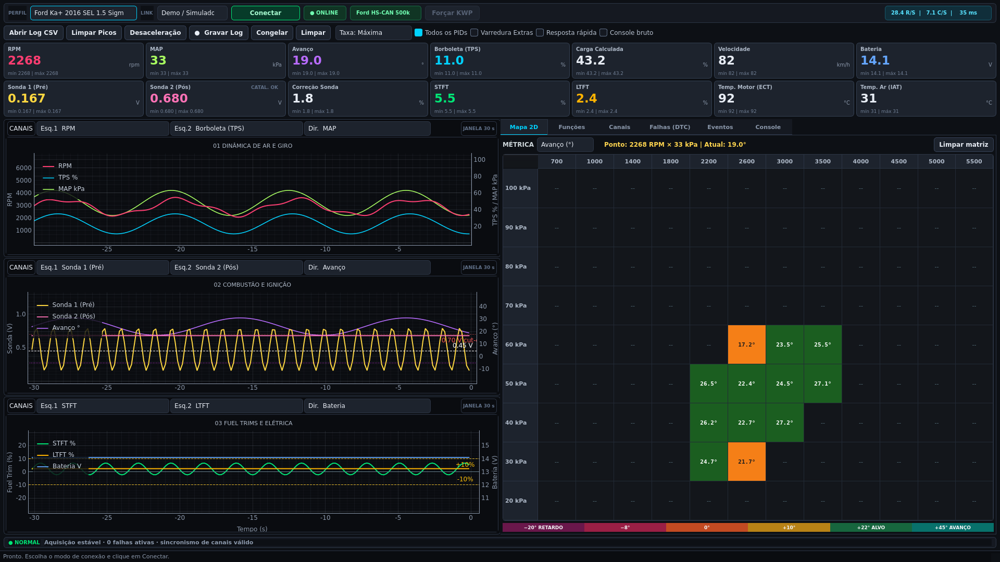
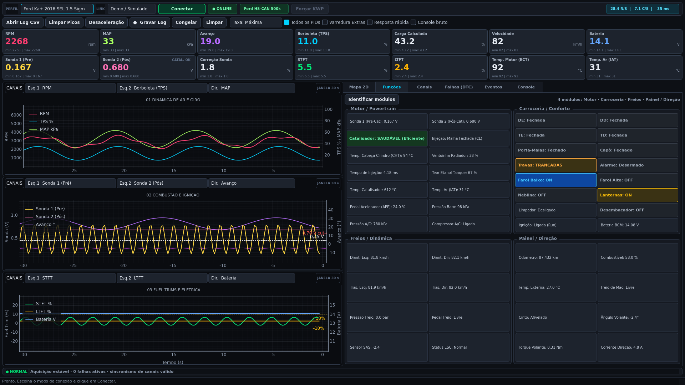

# leitorECU — Scanner Automotivo Universal & Datalogger de Alta Frequência

Aplicação desktop profissional de telemetria, análise de calibração e diagnóstico automotivo em tempo real desenvolvida em Python (PyQt6 + PyQtGraph rodando a 30 FPS estáveis). Projetada para comunicação de alta velocidade com centrais de injeção eletrônica e módulos de carroceria via barramento CAN (ISO 15765-4 / UDS ISO 14229), Linha K nativa (VAG KWP2000 ISO 14230-4 e VAG KW1281) e padrão SAE J1979 OBD-II universal.

Compatível com interfaces ELM327 (Bluetooth 4.0+ BLE, Wi-Fi TCP, USB Serial) e cabos seriais dedicados VAG-COM KKL 409.1 (FTDI/CH340).





---

## Sumário

1. [Versão Compilada para Download](#versão-compilada-para-download)
2. [Arquitetura Zero-Menu: Auto-Fingerprinting Universal](#arquitetura-zero-menu-auto-fingerprinting-universal)
3. [Compatibilidade de Veículos e Centrais](#compatibilidade-de-veículos-e-centrais)
4. [Recursos Principais e Ferramentas de Engenharia](#recursos-principais-e-ferramentas-de-engenharia)
5. [Interface Motorsport Telemetry](#interface-motorsport-telemetry)
6. [Canais Matemáticos e Estimativas Físicas](#canais-matemáticos-e-estimativas-físicas)
7. [Requisitos e Execução a partir do Código-Fonte](#requisitos-e-execução-a-partir-do-código-fonte)
8. [Procedimentos de Conexão](#procedimentos-de-conexão)
9. [Suíte de Testes Automatizados](#suíte-de-testes-automatizados)
10. [Estrutura do Repositório](#estrutura-do-repositório)

---

## Versão Compilada para Download

Para usuários do Microsoft Windows (10 ou 11 de 64 bits), o **leitorECU** está disponível como executável binário independente (*standalone*), dispensando a instalação prévia de Python ou dependências externas.

- **Arquivo Executável Standalone**: `dist/leitorECU.exe`
- **Tamanho aproximado**: ~70 MB (inclui runtime Python 3.13, bibliotecas gráficas PyQt6/PyQtGraph e drivers de rede)
- **Modo de Uso Direto**:
  1. Baixe o executável na aba de [Releases do GitHub](https://github.com/);
  2. Conecte sua interface (Bluetooth BLE, Wi-Fi, cabo USB serial ou selecione o modo Demo);
  3. Execute `leitorECU.exe` e clique em **Conectar**. O motor de Auto-Fingerprinting identifica a central e configura a tela automaticamente.

Para iniciar diretamente em modo de simulação sem hardware conectado:
```powershell
.\leitorECU.exe --demo
```

---

## Arquitetura Zero-Menu: Auto-Fingerprinting Universal

O aplicativo elimina completamente qualquer menu estático de seleção manual de veículo. O motor `UniversalAutoDiscovery` executa uma sonda em cascata (*cascading probe*) a partir do momento em que o usuário clica em **Conectar**, progredindo do barramento mais veloz para os mais lentos:

```text
                  [ Clique em Conectar ]
                             │
            ┌────────────────┴────────────────┐
            ▼                                 │
  [ 1. Sonda CAN Bus (ATSP6/7) ]              │ (se falhar em 0,3s)
  • Envia 0100, 0902 (VIN), 22F190            │
  • Consulta DIDs UDS 22F187 e 221624         │
  • Varre headers CAN (7E0, 726, 760, 730)    │
  • Detecta Continental EMS2211, Bosch CAN    │
            │ (Se responder)                  ▼
            ├───────────────► [ 2. Sonda K-Line Fast Init (ATSP5) ]
            │                 • ATSH 81 10 F1 + 1A9B (ReadECUId)
            │                 • Identifica ME7.5.30 e centrais ISO 14230
            │                 │ (se falhar em 1,5s)
            │                 ▼
            │               [ 3. Sonda K-Line 5-Baud Init (ATSP4/3) ]
            │               • ATIIA 01 + 1089 + 1A9B (VAG KWP2000)
            │               • Detecção de KeyBytes KW1281 (01 8A)
            │               • Suporte Bosch Motronic MP9.0 (Kombi 1.6 Ar)
            │               │ (se falhar em 3,5s)
            │               ▼
            │               [ 4. Fallback Universal OBD-II (ATSP0) ]
            │               • Varredura de bitmasks PIDs 0100, 0120, 0140
            │               • Identificação via VIN 0902 / WMI de montadora
            │
            ▼
[ UI Orientada a Capacidades + Polling Ativo Customizado ]
```

### Decodificador Universal de Identidade da ECU (`obd_app/ecu_id.py`)
Extrai metadados completos da resposta bruta dos serviços `1A 9B` (KWP2000), `09 02` (VIN OBD2) e `22 F1 87` (Part Number UDS):
- **Identificação do Fabricante por WMI**: `9BW` = Volkswagen Brasil, `9BF` = Ford Brasil, `9BG` = General Motors Brasil, `9BD` = Fiat Brasil, `3FA` = Ford México, etc.
- **Part Numbers VAG**: `032906032AJ` (VW EA111 1.6 Flex — Bosch ME7.5.30), `237906021` (VW Kombi 1.6 Ar — Bosch MP9.0), `036906034` (VW 1.0 16V — Magneti Marelli 4LV), entre outros.
- **Gravação de Metadados**: O identificador oficial e o protocolo ativo são inseridos diretamente no cabeçalho dos arquivos de telemetria CSV e laudos técnicos.

---

## Compatibilidade de Veículos e Centrais

### 1. Volkswagen Kombi 1999 1.6 a Ar Injetada (Bosch Motronic MP9.0 — Protocolo KW1281)
- **Desafio Físico**: A central MP9.0 (Part Number típico `237 906 021.X`) opera via Linha K a 9.600 baud com inicialização 5-baud no endereço `0x01` e exige handshake de inversão de complemento (*byte-echo*) a cada byte trafegado.
- **Solução Implementada**: 
  - Módulo [`obd_app/protocols/kw1281.py`](file:///c:/Users/rsaho/Desktop/leitorECU3/leitorECU/leitorECU/obd_app/protocols/kw1281.py) com decodificação direta dos blocos ASCII e numéricos de células KW1281.
  - Driver [`KklSerialTransport`](file:///c:/Users/rsaho/Desktop/leitorECU3/leitorECU/leitorECU/obd_app/transports.py) para conexão direta via cabos USB KKL 409.1 (FTDI/CH340).
  - Aquisição em tempo real dos Blocos `001` a `008`: RPM, Ângulo de Avanço de Ignição, Tempo de Injeção real (`ms`), Temperatura do Óleo e Cabeçote, Tensão da Sonda Lambda e Tensão de Bateria.
  - Detecção transparente de KeyBytes `01 8A` em adaptadores ELM327 com recomendação automática de conexão via cabo KKL.

### 2. Linha Volkswagen TotalFlex (Bosch Motronic ME7.5.30 — VAG KWP2000)
- **Comunicação Nativa**: ISO 14230-4 K-Line via Serviço `0x21` (Blocos de Medição `001` a `255`).
- **Blocos Síncronos e Alta Resolução**: Bloco `003` (RPM, MAP, TPS e Avanço em frame único de 12 bytes sem defasagem temporal), Bloco `002` (Tempo de Injeção em ms e fluxo de ar), Bloco `020`/`026` (Retardo individual por cilindro 1 a 4 e tensão de detonação em Volts), Bloco `032`/`033` (STFT e LTFT em marcha lenta e carga parcial, Sonda Lambda 1 com oscilação contínua 0,10 V a 0,85 V).
- **Reset de Mistura Flex**: Procedimento de reinicialização dos adaptativos via Canal `00` na EEPROM.

### 3. Ford Ka+ 1.5 16V Sigma Flex e Carros Modernos (Rede CAN 500k UDS)
- **PCM (0x7E0 / 0x7E8)**: Leitura simultânea de Sonda 1 (B1S1 pré-catalisador) e Sonda 2 (B1S2 pós-catalisador), avaliação de eficiência do catalisador em tempo real, status de malha (Open/Closed Loop), temperatura da cabeça do cilindro (CHT), eletroventilador PWM %, pressão de linha do ar-condicionado e teor de etanol.
- **Multimódulos CAN**: BCM Carroceria (`0x726`), Freios ABS/ESC com velocidade individual das 4 rodas (`0x760`), Direção Elétrica EPAS (`0x730`) e Painel de Instrumentos IPC (`0x720`).

### 4. Padrão OBD-II Universal (ISO 15765-4, ISO 14230-4, ISO 9141-2, SAE J1850)
- Suporte a qualquer veículo comercial que responda aos PIDs SAE J1979 Modos 01, 02, 03, 04, 07, 09 e 0A.

---

## Recursos Principais e Ferramentas de Engenharia

| Funcionalidade | Descrição Técnica |
|---|---|
| **Osciloscópio Triplo Customizável (30 FPS)** | Três gráficos de duplo eixo Y desacoplados compartilhando base temporal sincronizada de 30 segundos. Cada traço possui seletor dinâmico individual (`Esq.1`, `Esq.2`, `Dir.`) para alternar entre qualquer canal físico ou virtual da ECU. |
| **Barra de Telemetria Viva nos Gráficos** | Cabeçalho fino de 22px integrado no topo de cada gráfico contendo bolinha colorida correspondente à curva, seletor compacto e leitura digital numérica em tempo real em fonte monoespaçada. |
| **Matriz Térmica 2D Operacional (RPM × MAP)** | Grid acumulativo de 12 colunas de rotação (700 a 5.500 RPM) por 9 linhas de pressão absoluta (20 a 100 kPa). Destaca em tempo real a célula ativa com contorno ciano de 2px e guia visual de eixos (`▲ MAP kPa │ ► RPM`). Modos estatísticos: Média, Máximo, Mínimo e Contagem de Ocorrências (Hits). |
| **Exportação MegaLogViewer HD (.msl)** | Exportador nativo de logs tabulados formatados rigorosamente conforme a especificação EFI Analytics / TunerStudio, permitindo análise profunda de transitórios e mapas em softwares externos de calibração. |
| **Temporizadores de Performance Arrancada & Frenagem** | Módulo de telemetria de pista medindo automaticamente 0-60 km/h, 0-100 km/h, 100-200 km/h, 201m (1/8 milha), 402m (1/4 milha) e distância/tempo de frenagem 100-0 km/h com filtro contra falso disparo. |
| **Monitores de Prontidão (I/M Readiness)** | Diagnóstico completo de emissões via Modo 01 PID 01 (status da lâmpada MIL, contagem de DTCs gravados e tabela detalhada de monitores contínuos e não-contínuos para ciclos Otto e Diesel). |
| **Dados Congelados da Falha (Freeze Frame)** | Leitura do Modo 02 com reconstrução de todos os parâmetros operacionais do motor no instante exato em que o código de falha gerador do congelamento foi registrado. |
| **Gerador de Laudos Técnicos (PDF Vetorial & HTML)** | Emissão de relatórios completos de diagnóstico contendo dados do veículo, VIN, DTCs ativos, histórico, monitores de emissão e teste de bateria, exportáveis em HTML formatado e PDF vetorial nativo via `QPdfWriter`. |
| **Alertas Sonoros Sintetizados Não-Bloqueantes** | Monitor de Shift Light por rotação e alarme de temperatura crítica de arrefecimento (ECT) operando em `QThread` assíncrona desacoplada via `winsound.Beep`. |
| **Diálogo de Ajustes Persistentes** | Configuração de massa do veículo (kg), preço do combustível (R$/L), limiar de rotação do Shift Light e temperatura crítica ECT, persistidos via `QSettings`. |

---

## Interface Motorsport Telemetry

A interface foi projetada com base em princípios ergonômicos de telemetria esportiva profissional (MoTeC i2 e Bosch WinDARAB):

- **Geometria Retangular e Aproveitamento Total de Espaço**: Padronização estrita com `border-radius: 0px` em todos os elementos visuais (cards, botões, tabelas, abas, barras de rolagem e caixas de diálogo).
- **Redução de Ruído Visual**: Fundo estruturado em camadas de profundidade (`#0D1015`, `#13171F`, `#151A22`, `#181E27`) com divisórias finas de 1px em cinza escuro, substituindo contornos pesados e cansativos.
- **Grid Espacial Unificado de 8px**: Margens e espaçamentos internos padronizados, garantindo alinhamento pixel-a-pixel entre cards, osciloscópios e matriz 2D.
- **Tipografia Monoespaçada**: Fontes `JetBrains Mono` e `Consolas` em todas as leituras numéricas dinâmicas para evitar oscilações de layout durante variações rápidas de valores.
- **Checkboxes Vetoriais Sóbrias**: Indicadores com preenchimento ciano suave (`#236B7A`) e ícone vetorial de checkmark SVG nítido.
- **Estado de Conexão Inequívoco**: Em repouso, o único elemento verde ativo na tela é o botão de ação **Conectar**, enquanto o indicador de protocolo exibe `SEM PROTOCOLO` em cinza neutro.

---

## Canais Matemáticos e Estimativas Físicas

O motor `MathChannelsEngine` processa em tempo real canais virtuais de alta utilidade:

1. **Potência Estimada às Rodas (WHP) e Torque (kgfm)**: Calculados a partir da taxa de variação de velocidade ($\frac{\Delta v}{\Delta t}$), massa configurada do veículo, perdas parasíticas estimadas e rotação do motor.
2. **Eficiência Volumétrica (VE%)**: Calculada dinamicamente pelo método Speed-Density utilizando Pressão Absoluta no Coletor (MAP), Temperatura do Ar Admitido (IAT), Rotação (RPM) e deslocamento volumétrico configurado.
3. **Consumo Instantâneo de Combustível (km/l e L/h)**: Estimado a partir do fluxo de massa de ar (MAF direto ou estimado por Speed-Density), relação ar/combustível estequiométrica (AFR) ajustada pelo teor de etanol Flex e velocidade instantânea reportada.
4. **Custo Operacional por Quilômetro (R$/km)**: Calculado em tempo real cruzando a taxa de consumo instantâneo com o preço do litro de combustível configurado.
5. **Analisador de Queda de Tensão na Partida (Cranking Drop)**: Monitora a resposta do conversor analógico-digital durante a transição de rotação de 0 para >200 RPM. Se a tensão cair abaixo de 9,6 V, emite alerta de bateria fraca ou resistência de aterramento.

---

## Requisitos e Execução a partir do Código-Fonte

### Requisitos de Sistema
- **Sistema Operacional**: Windows 10 ou Windows 11 (recomendado para suporte pleno a Bluetooth BLE).
- **Python**: Versão 3.10 ou superior (testado e otimizado para Python 3.13 de 64 bits).

### Instalação de Dependências
Clone o repositório e instale as dependências listadas no `requirements.txt`:

```powershell
pip install -r requirements.txt
```

Dependências principais:
- `PyQt6 >= 6.5`
- `pyqtgraph >= 0.13`
- `numpy >= 1.24`
- `bleak >= 0.21` (comunicação GATT Bluetooth Low Energy)
- `pyserial >= 3.5` (opcional, recomendado para cabos seriais KKL / Pass-Thru)

### Inicialização
Para abrir a aplicação:
```powershell
python main.py
```

Para abrir diretamente no modo de demonstração/simulador:
```powershell
python main.py --demo
```

---

## Procedimentos de Conexão

### Bluetooth BLE (Adaptadores Vgate iCar Pro BLE 4.0)
1. Conecte a interface na porta OBD-II do veículo e ligue a ignição.
2. **Atenção**: Não realize o pareamento nas configurações de Bluetooth do Windows. O driver `bleak` comunica-se diretamente via GATT. Caso o dispositivo tenha sido pareado anteriormente no painel do Windows, remova o pareamento.
3. Certifique-se de que nenhum aplicativo de smartphone esteja conectado à interface.
4. No leitorECU, selecione o modo **Bluetooth BLE**, clique em **Buscar**, selecione o dispositivo na lista e clique em **Conectar**.

### Wi-Fi (Adaptadores TCP/IP)
1. Conecte a rede Wi-Fi do computador ao ponto de acesso gerado pelo adaptador OBD-II.
2. No leitorECU, selecione o modo **Wi-Fi (TCP)**, verifique o IP e Porta (padrão `192.168.0.10:35000`) e clique em **Conectar**.

### Cabo USB Serial / KKL (VAG-COM 409.1)
1. Conecte o cabo USB na porta do computador e na porta de diagnóstico do veículo.
2. No leitorECU, selecione o modo **USB Serial / KKL (COM)**, escolha a porta serial correspondente (ex: `COM3`) e o baud rate apropriado (`9600` para KW1281 / MP9.0 ou `38400`/`115200` para ELM327 USB).
3. Clique em **Conectar**.

---

## Suíte de Testes Automatizados

O projeto conta com **99 testes automatizados** cobrindo estratégias de inicialização, protocolos aspirados e Turbo/Wideband/GDI, detecção de falhas (Cut-Off, Overboost, Underboost, Knock), algoritmos de cálculo, integração de interface gráfica (1080p, Mapa 2D 250 kPa, Replay CSV) e exportação de relatórios:

```powershell
py -3.13 -m pytest tests/ -v
```

Resultado da suíte de testes:
```text
============================= 99 passed in 11.22s =============================
```

---

## Estrutura do Repositório

```text
leitorECU/
├── main.py                         # Ponto de entrada da aplicação desktop
├── requirements.txt                # Dependências Python do projeto
├── README.md                       # Documentação completa de usuário e engenharia
├── AGENTS.md                       # Especificação técnica aprofundada de protocolos
├── docs/
│   └── images/                     # Capturas de tela da interface para documentação
├── cache/                          # Cache local JSON de blocos KWP2000 e DIDs por ECU
├── logs/                           # Diretório de armazenamento de datalogs CSV e MSL
├── obd_app/
│   ├── interfaces.py               # Protocolos de tipagem estática (WorkerContext)
│   ├── transports.py               # Camada física: BLE (bleak), TCP, Serial KKL e Mock
│   ├── ble_scan.py                 # Descoberta assíncrona de dispositivos Bluetooth BLE
│   ├── elm327.py                   # Driver ELM327, parser hexadecimal e controle AT
│   ├── ecu_id.py                   # Decodificador de VIN, WMI, Part Numbers e nomes de ECU
│   ├── math_channels.py            # Motor de canais virtuais (WHP, Torque, VE%, Consumo)
│   ├── performance.py              # Temporizador de aceleração (0-100, 402m) e frenagem
│   ├── audio_alerts.py             # Alertas sonoros multithreaded para Shift Light e ECT
│   ├── report_generator.py         # Gerador de laudos técnicos em PDF vetorial e HTML
│   ├── datalog.py                  # Gravação CSV dinâmica e exportador MegaLogViewer (.msl)
│   ├── pids.py                     # Definições de PIDs SAE J1979 Modo 01 e canais semânticos
│   ├── vag.py                      # Fórmulas VAG KWP2000 e catálogo de labels de blocos
│   ├── ford.py                     # Módulos HS-CAN e DIDs Ford UDS (Modo 22)
│   ├── dtc.py                      # Decodificador de códigos de falha e heurística SAE J2012
│   ├── detector.py                 # Máquina de estados para detecção de anomalias de vácuo e ignição
│   ├── mock_engine.py              # Simulador físico de dinâmica veicular e injeção de falhas
│   ├── worker.py                   # QThread de aquisição e coordenação de estratégias
│   ├── protocols/                  # Motor de comunicação por protocolo
│   │   ├── autodiscovery.py        # Probe em cascata UniversalAutoDiscovery
│   │   ├── base.py                 # Classe abstrata ProtocolStrategy
│   │   ├── kw1281.py               # Protocolo VAG KW1281 (Kombi 1.6 Ar Bosch MP9.0)
│   │   ├── vag.py                  # Protocolo VAG KWP2000 (Bosch ME7.5.30)
│   │   ├── ford.py                 # Protocolo Ford HS-CAN 500k UDS
│   │   └── generic.py              # Protocolo OBD-II Universal SAE J1979
│   └── ui/                         # Design system e componentes visuais PyQt6 / PyQtGraph
│       ├── main_window.py          # Janela principal com layout motorsport e abas adaptativas
│       ├── map2d.py                # Matriz operacional 2D térmica (RPM x MAP)
│       ├── plots.py                # Osciloscópio triplo com barra de telemetria integrada
│       ├── widgets.py              # Cards de telemetria com retenção de picos e bullets coloridos
│       ├── check.svg               # Marcação vetorial SVG nítida para caixas de seleção
│       └── style.py                # Design system retangular de alta densidade (QSS)
└── tests/                          # 99 testes automatizados com pytest (inclui suítes Turbo & UI)
```
