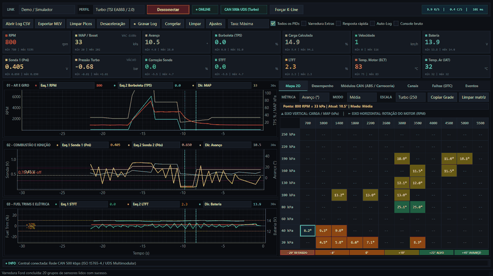
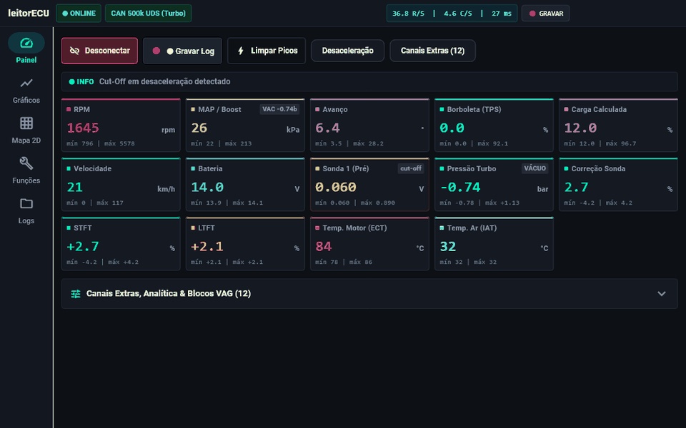
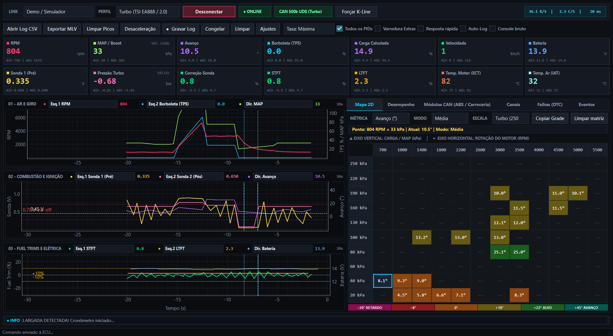
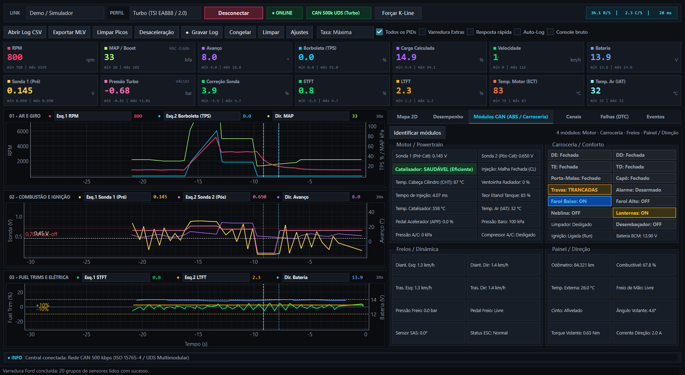
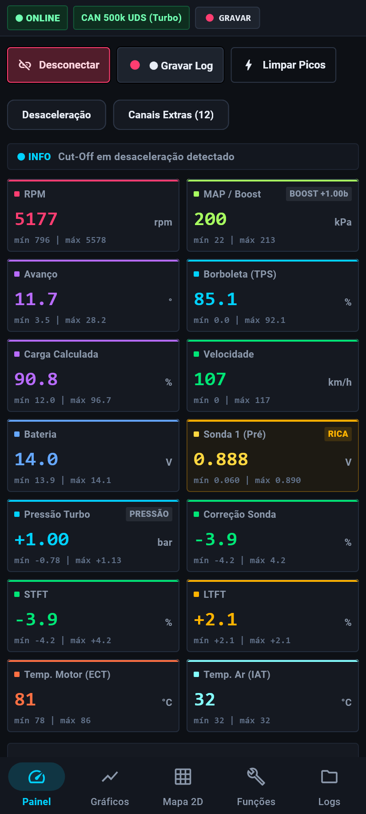
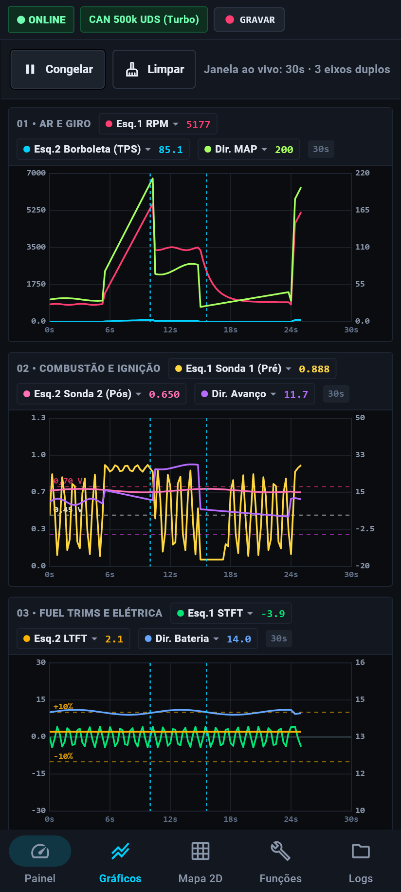
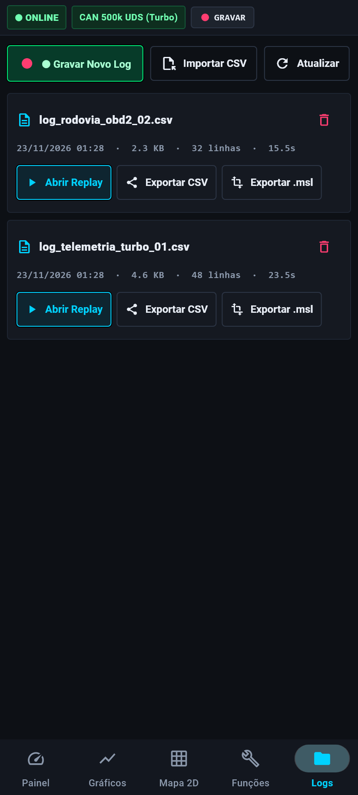
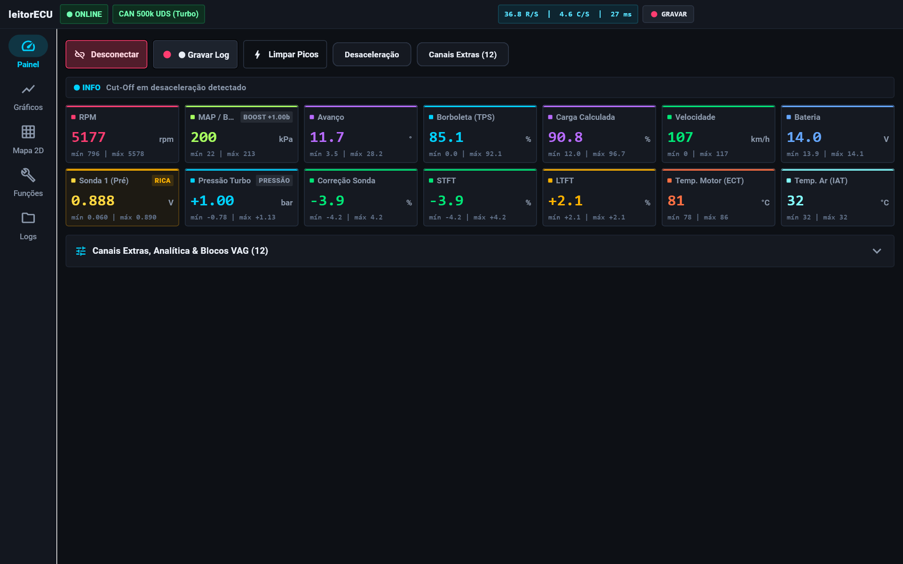

# leitorECU — Datalogger & Scanner Automotivo Multiplataforma

Suíte de telemetria automotiva, datalogging de alta frequência e diagnóstico eletrônico composta por aplicação **Desktop** (Python, PyQt6 e PyQtGraph a **30 FPS**) e aplicativo **Mobile & Tablet** (Flutter com interface responsiva). Projetado para aquisição contínua em tempo real com interfaces OBD-II padrão **Bluetooth Low Energy (BLE 4.0+)**, **Wi-Fi TCP** e **USB Serial / KKL**, operando nos barramentos **CAN (ISO 15765-4 / UDS ISO 14229)**, **Linha K (KWP2000 ISO 14230-4 / KW1281)** e **SAE J1979 OBD-II universal**.

---

## Demonstração em Funcionamento

### Desktop (30 FPS · Osciloscópio Triplo · Mapa 2D · Diagnóstico CAN)



### Mobile & Tablet (Layout Responsivo · Gráficos Separados · Biblioteca e Exportação de Logs)



---

## Capturas de Tela

### Versão Desktop (PyQt6 + PyQtGraph)

| Telemetria ao Vivo, Osciloscópio e Mapa 2D (RPM × MAP) | Diagnóstico Multimodular CAN (Motor, Carroceria, ABS, Painel) |
|:---:|:---:|
|  |  |

### Versão Mobile & Tablet (Flutter)

<p align="center">
  
  &nbsp;&nbsp;
  
  &nbsp;&nbsp;
  
</p>



---

## Sumário

1. [Arquitetura Zero-Menu: Auto-Fingerprinting Universal](#arquitetura-zero-menu-auto-fingerprinting-universal)
2. [Como Funciona o App Desktop](#como-funciona-o-app-desktop)
3. [Como Funciona o App Mobile & Tablet](#como-funciona-o-app-mobile--tablet)
4. [Protocolos e Motores Suportados](#protocolos-e-motores-suportados)
5. [Canais Matemáticos e Estimativas Físicas](#canais-matemáticos-e-estimativas-físicas)
6. [Requisitos e Execução a partir do Código-Fonte](#requisitos-e-execução-a-partir-do-código-fonte)
7. [Procedimentos de Conexão](#procedimentos-de-conexão)
8. [Estrutura do Repositório](#estrutura-do-repositório)

---

## Arquitetura Zero-Menu: Auto-Fingerprinting Universal

O aplicativo elimina seletores manuais estáticos de veículo. Ao clicar em **Conectar**, o motor `UniversalAutoDiscovery` executa uma sonda em cascata (*cascading probe*) do barramento mais veloz até os protocolos legados:

```text
                  [ Clique em Conectar ]
                             │
            ┌────────────────┴────────────────┐
            ▼                                 │
  [ 1. Sonda CAN Bus (ATSP6/7) ]              │ (se falhar)
  • Envia 0100, 0902 (VIN), 22F190            │
  • Consulta Part Numbers UDS (22F187)        │
  • Mapeia módulos CAN (PCM, BCM, ABS, IPC)   │
            │ (Se responder)                  ▼
            ├───────────────► [ 2. Sonda K-Line Fast Init (ATSP5) ]
            │                 • ATSH 81 10 F1 + 1A9B (ReadECUId)
            │                 • Identifica centrais ISO 14230 / KWP2000
            │                 │ (se falhar)
            │                 ▼
            │               [ 3. Sonda K-Line 5-Baud Init (ATSP4/3) ]
            │               • ATIIA 01 + 1089 + 1A9B (KWP2000 Modo 21)
            │               • Detecção automática de KeyBytes KW1281
            │               │ (se falhar)
            │               ▼
            │               [ 4. Fallback Universal OBD-II (ATSP0) ]
            │               • Varredura de bitmasks PIDs 0100, 0120, 0140
            │               • Mapeamento automático de sondas e trims
            │
            ▼
  [ Interface Orientada a Capacidades + Polling Adaptativo ]
```

### Decodificação de Identidade e Capacidades (`ecu_id` / `ecu_fingerprints`)
A leitura inicial identifica fabricante (WMI do VIN), arquitetura da central, presença de sobrealimentação (**Turbo / Boost / GDI / Wideband**), quantidade de sondas lambda e módulos auxiliares disponíveis na rede CAN, adaptando dinamicamente os cards, eixos de gráficos, escalas de pressão do Mapa 2D e abas visíveis.

---

## Como Funciona o App Desktop

Projetado para análise avançada de telemetria e calibração em tempo real a **30 FPS** com estilo visual retangular inspirado em sistemas de telemetria de competição (*dark motorsport*):

| Funcionalidade | Descrição Técnica |
|---|---|
| **Grid de 14 Cards com Peak Hold** | Leituras digitais em fonte monoespaçada com retenção contínua de **mínimo e máximo**, detecção de mistura (Rica/Pobre/Estequiométrica), pressão positiva de **Boost (bar/kPa)** e estados visuais de alerta, aviso ou canal obsoleto (*stale*). |
| **Osciloscópio Triplo Customizável** | Três gráficos sincronizados com duplo eixo Y em janela deslizante de 30 segundos. Cada curva possui seletor individual (`Esq.1`, `Esq.2`, `Dir.`) e barra superior com leitura numérica viva. |
| **Matriz Térmica 2D (RPM × MAP)** | Grade acumulativa de 12 faixas de rotação (**700 a 5.500 RPM**) por linhas de pressão absoluta com comutação automática entre escala **Aspirada (20–100 kPa)** e **Turbo (20–250 kPa)**. Suporta modos **Média, Máximo, Mínimo e Contagem (Hits)**, cópia tabulada para planilhas e destaque em tempo real da célula ativa. |
| **Gravação Dinâmica CSV & Exportação .MSL** | Registra canais fixos e canais extras/blocos descobertos dinamicamente em arquivo **CSV** compatível com Excel em português (`;`), com opção de **Auto-Log** por carga/aceleração e conversão direta para formato **MegaLogViewer HD / TunerStudio (`.msl`)**. |
| **Modo Replay CSV com Crosshair** | Carrega qualquer log gravado para análise ponto a ponto após a coleta: o cursor sincronizado nos gráficos atualiza instantaneamente os 14 cards, as leituras digitais e a posição ativa no Mapa 2D. |
| **Diagnóstico Completo e Laudos PDF** | Leitura e limpeza de códigos de falha (**DTC** Modo 03/04 e KWP2000 Serviço 18/14), monitores de emissões (**I/M Readiness** Modo 01 PID 01), dados congelados (**Freeze Frame** Modo 02), reset de adaptativos e emissão de laudos técnicos vetoriais em **PDF** e **HTML**. |
| **Cronômetro de Performance e Alertas** | Medição automática de **0–60 km/h**, **0–100 km/h**, **100–200 km/h**, **201 m**, **402 m** e frenagem **100–0 km/h**, além de alertas sonoros assíncronos de *Shift Light* e temperatura crítica de arrefecimento. |
| **Detecção Automática de Anomalias** | Máquina de estados em tempo real identificando corte de combustível em desaceleração (**Cut-Off / DFCO**), retardo crítico de ignição/detonação, conflito de vácuo/dashpot, desvios de mistura (*Fuel Trims*) e *Overboost*/*Underboost*. |

---

## Como Funciona o App Mobile & Tablet

Desenvolvido em **Flutter** para eliminar a dependência de notebook durante coletas prolongadas em trânsito ou pista, mantendo paridade funcional completa com o cliente desktop:

- **Interface Responsiva Adaptativa**:
  - **Smartphones (`< 840 dp`)**: Navegação inferior ergonômica via `NavigationBar` e grade de cards otimizada em 2 colunas para leitura rápida com uma mão.
  - **Tablets (`>= 840 dp`)**: Barra lateral fixa via `NavigationRail`, distribuição multi-coluna ampliada no painel e cabeçalho estendido com taxa de amostragem (`R/S`, `C/S` e latência em `ms`).
- **Painel Focado em Dados e Ações Rápidas**: Topo permanente com status de conexão, protocolo ativo e botão **GRAVAR / PARAR** com contador ao vivo de amostras, seguido pelos cards de telemetria com *Peak Hold* e seção expansível de canais extras.
- **Gráfico Individual ao Tocar nos Cards**: Tocar em qualquer card principal ou canal extra abre um gráfico exclusivo daquele parâmetro (tanto **ao vivo** quanto em **Modo Replay**) com cartões **Atual / Mínimo / Média / Máximo**, janelas (`15s`, `30s`, `60s`, `Tudo`), congelamento, linhas de referência diagnósticas, **Crosshair por toque/arrasto** e botão **Fixar nos Gráficos**.
- **Gráficos em Aba Dedicada**: Os três gráficos sincronizados de duplo eixo Y (`Ar e Giro`, `Combustão e Ignição`, `Fuel Trims e Elétrica`) ficam isolados na aba **Gráficos**, sem competir por espaço visual com os cards do painel.
- **Mapa 2D, Funções e Performance no Celular**: Matriz térmica interativa RPM × MAP (com escala automática Turbo até 250 kPa), leitura/limpeza de DTCs, Readiness, Freeze Frame, módulos CAN estendidos e cronômetro de arrancada/frenagem integrados.
- **Biblioteca Interna de Logs e Exportação Multiformato**: Aba **Logs** dedicada listando todas as sessões salvas no aparelho com data, tamanho, número de amostras e duração — permitindo **abrir qualquer sessão em Modo Replay com Crosshair**, **importar CSVs externos**, ou exportar e compartilhar diretamente no celular em **Excel (`.xlsx`)** multi-abas (`Resumo`, `Telemetria` e `Eventos`), **Relatório Web interativo (`.html`)** com gráficos SVG, **Relatório PDF (`.pdf`)** vetorial, **JSON (`.json`)**, **CSV (`.csv`)** e **MegaLogViewer (`.msl`)**.
- **Execução Contínua em Segundo Plano & Conexão BLE / Wi-Fi / Demo**: Descoberta BLE via GATT (`flutter_blue_plus`), socket TCP para adaptadores Wi-Fi, simulador integrado e **Android Foreground Service** nativo com `PARTIAL_WAKE_LOCK`, `WifiLock` e notificação persistente para manter a coleta ativa com o app minimizado ou a tela apagada — com botão **Liberar 2º Plano** (isenção de otimização de bateria) e opção de manter tela acesa na janela de conexão.
- **Cálculo Contínuo em Pacotes Parciais e Standby**: Mesclagem automática do último estado conhecido de sensores para que pacotes parciais não zerem métricas estimadas (como consumo em `L/h` e `VE %`), proteção contra lacunas de suspensão no cálculo de distância (`trip_km`) e aceleração longitudinal (`accel_g`), além de proteção contra duplicação de unidades nos cabeçalhos CSV.

---

## Protocolos e Motores Suportados

- **Padrão OBD-II Universal (SAE J1979)**: Leitura de PIDs Modos `01`, `02`, `03`, `04`, `07`, `09` e `0A` sobre CAN (`ISO 15765-4`), `ISO 14230-4`, `ISO 9141-2` e `SAE J1850`, incluindo suporte completo a **sonda dupla (pré e pós-catalisador)** para diagnóstico de eficiência catalítica.
- **Redes CAN Multimodulares e UDS (`ISO 14229` Modo 22)**: Consulta paralela e organizada por módulos eletrônicos além do motor (**Powertrain/PCM**, **Carroceria/BCM**, **Freios ABS/ESC**, **Painel/IPC** e **Direção Elétrica/PSCM**), exibindo parâmetros como CHT, APP, ciclo PWM de eletroventilador, velocidade individual das 4 rodas, ângulo de esterçamento e status de travas/iluminação.
- **Motores Sobrealimentados, Wideband & Injeção Direta (Turbo / GDI)**: Suporte nativo aos PIDs `0123` (Pressão de Rail GDI em bar), `0124`/`0144` (Sonda Banda Larga $\lambda$ / AFR), `0170` (Alvo vs. Boost real e ciclo da Wastegate), `0177` (Temperatura pós-Intercooler CAC) e mapeamento VAG KWP2000 específico de carga e *Boost* (Blocos `114`, `115`, `118`), com escala de Mapa 2D estendida para **250 kPa**.
- **Protocolos VAG K-Line Nativos (`KWP2000` Serviço 21 e `KW1281`)**: Aquisição direta dos blocos de medição `001` a `255` via Linha K (inclusive centrais que omitem trims e sonda no Modo 01 genérico), leitura de retardo de detonação individual por cilindro, armazenamento de blocos em cache JSON e suporte a cabos USB KKL via porta serial.

---

## Canais Matemáticos e Estimativas Físicas

O motor `MathChannelsEngine` deriva canais virtuais sincronizados em tempo real a partir dos sensores da central e dos parâmetros de configuração (massa do veículo, deslocamento volumétrico e preço de combustível):

1. **Pressão Relativa de Turbo (`boost_bar` / `boost_psi`)**: Subtração contínua entre MAP e pressão barométrica ambiente (`baro`), alternando automaticamente entre regime de vácuo e pressão positiva.
2. **Potência Estimada às Rodas (cv / WHP) e Torque (kgfm)**: Estimados a partir da aceleração instantânea ($\frac{\Delta v}{\Delta t}$), massa configurada do veículo, perdas de transmissão/rolagem e rotação atual.
3. **Eficiência Volumétrica (`VE %`)**: Cálculo *Speed-Density* cruzando MAP, temperatura do ar admitido (IAT) e RPM.
4. **Consumo Instantâneo (`km/l` e `L/h`) e Custo (`R$/km`)**: Estimativa por fluxo de massa de ar e relação ar/combustível ajustada por sonda/teor de etanol.
5. **Análise de Queda de Tensão na Partida (*Cranking Drop*)**: Monitora o vale mínimo da bateria durante a transição de partida; quedas abaixo de **9,6 V** geram alerta preventivo de bateria ou aterramento.

---

## Requisitos e Execução a partir do Código-Fonte

### Requisitos (Desktop)
- **Sistema Operacional**: Windows 10 ou Windows 11 (64 bits) — suporte pleno a Bluetooth BLE via GATT.
- **Python**: 3.10 ou superior (otimizado para Python 3.13).

### Instalação e Execução (Desktop)
```powershell
pip install -r requirements.txt
python main.py
```

Para abrir o aplicativo diretamente no **Modo Demo / Simulador** sem hardware OBD-II conectado:
```powershell
python main.py --demo
```

Dependências principais: `PyQt6 >= 6.5`, `pyqtgraph >= 0.13`, `numpy >= 1.24`, `bleak >= 0.21` e `pyserial >= 3.5`.

### Requisitos e Compilação (Mobile & Tablet — Flutter)
```powershell
cd leitorECU_mobile
flutter pub get
flutter build apk --release
```

---

## Procedimentos de Conexão

### Bluetooth BLE (Adaptadores Bluetooth 4.0+)
1. Conecte a interface na tomada OBD-II e ligue a ignição.
2. Caso o adaptador tenha sido pareado previamente nas configurações do sistema operacional, remova o pareamento: o aplicativo comunica-se diretamente via camada GATT sem exigir pareamento clássico.
3. Certifique-se de que nenhum outro app esteja conectado ao adaptador no mesmo momento.
4. Selecione **Bluetooth BLE**, clique em **Buscar**, escolha o dispositivo e toque/clique em **Conectar**.

### Wi-Fi (Adaptadores TCP/IP)
1. Conecte o computador ou dispositivo móvel à rede Wi-Fi criada pelo adaptador OBD-II.
2. Selecione **Wi-Fi (TCP)**, confira IP e Porta (padrão `192.168.0.10:35000`) e inicie a conexão.

### Cabo USB Serial / KKL (Desktop)
1. Conecte o cabo USB serial/KKL ao computador e à porta OBD-II.
2. Selecione **USB Serial / KKL (COM)**, escolha a porta COM detectada e o *baud rate* adequado (`9600` para KW1281 ou `38400`/`115200` para interfaces ELM327 USB).
3. Clique em **Conectar**.

---

## Estrutura do Repositório

```text
leitorECU/
├── main.py                         # Ponto de entrada da aplicação desktop
├── requirements.txt                # Dependências Python do projeto
├── README.md                       # Documentação de funcionamento e uso
├── docs/
│   └── images/                     # Capturas de tela e GIFs de demonstração
├── cache/                          # Cache local JSON de blocos e DIDs descobertos
├── logs/                           # Diretório de datalogs gravados (CSV / MSL)
└── obd_app/
    ├── interfaces.py               # Interfaces e contratos de contexto desacoplados
    ├── transports.py               # Transporte físico: BLE (bleak), Wi-Fi TCP, USB Serial e Demo
    ├── ble_scan.py                 # Descoberta assíncrona de adaptadores Bluetooth BLE
    ├── elm327.py                   # Driver ELM327, controle AT e extração hexadecimal
    ├── ecu_fingerprints.py         # Decodificador universal de VIN, WMI e Part Numbers
    ├── math_channels.py            # Motor de canais virtuais (Boost, WHP, Torque, VE%, Consumo)
    ├── performance.py              # Cronômetro de arrancada e frenagem
    ├── audio_alerts.py             # Alertas sonoros assíncronos de rotação e temperatura
    ├── report_generator.py         # Gerador de laudos técnicos vetoriais em PDF e HTML
    ├── datalog.py                  # Gravação CSV dinâmica e exportador MegaLogViewer (.msl)
    ├── pids.py                     # Definições de PIDs SAE J1979 e decodificação multi-canal
    ├── vag.py                      # Fórmulas KWP2000 e catálogo dinâmico de blocos
    ├── ford.py                     # Mapeamento CAN multimodular e DIDs UDS Modo 22
    ├── dtc.py                      # Decodificador de códigos de falha DTC
    ├── detector.py                 # Máquina de estados para Cut-Off, mistura e anomalias Turbo
    ├── mock_engine.py              # Simulador físico de dinâmica veicular em modo Demo
    ├── worker.py                   # Thread de aquisição em alta frequência e Power Latch
    ├── protocols/                  # Motor de protocolos (UniversalAutoDiscovery, CAN, K-Line, OBD-II)
    └── ui/                         # Design system, cards, osciloscópio triplo e Mapa 2D

leitorECU_mobile/                   # Aplicativo Android/iOS em Flutter (Mobile & Tablet)
├── pubspec.yaml                    # Dependências Flutter (BLE, Wakelock, FilePicker, SharePlus)
├── android/                        # Manifest, Foreground Service nativo (WakeLock/WifiLock) e Gradle
└── lib/
    ├── analytics/                  # Detector de eventos, canais matemáticos, DTCs e Readiness
    ├── core/                       # Modelos de canais/perfis, ELM327, protocolos, transportes e Foreground Service
    ├── state/                      # Controlador reativo de telemetria, gravação e Replay
    ├── storage/                    # Logger CSV, parser de Replay e exportadores (.xlsx, .html, .pdf, .json, .msl)
    └── ui/                         # Telas responsivas, gráfico dedicado por card, Mapa 2D e tema Motorsport
```
