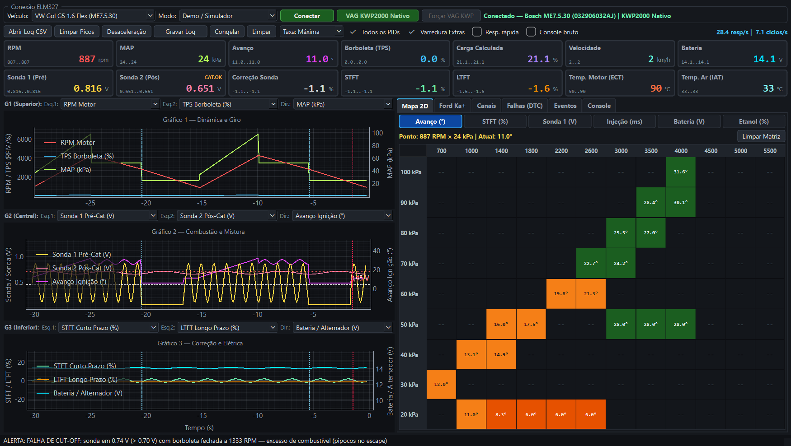
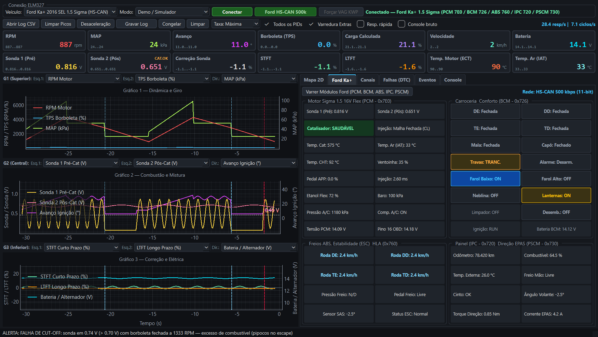

# Datalogger OBD2 — Diagnóstico Avançado VAG KWP2000 & Ford HS-CAN (UDS)

Aplicação desktop de telemetria e diagnóstico automotivo em tempo real desenvolvida em Python (PyQt6 + PyQtGraph a 30 FPS), projetada para aquisição de dados de alta frequência, análise de calibração e diagnóstico multimodular via interfaces baseadas no controlador ELM327 (Bluetooth BLE, Wi-Fi TCP e Simulador Integrado).





---

## Sumário

1. [Visão Geral e Perfis Suportados](#visão-geral-e-perfis-suportados)
2. [Principais Funcionalidades e Recursos](#principais-funcionalidades-e-recursos)
3. [Arquitetura do Sistema](#arquitetura-do-sistema)
4. [Requisitos e Instalação](#requisitos-e-instalação)
5. [Execução e Operação](#execução-e-operação)
6. [Procedimento de Conexão (Bluetooth BLE e Wi-Fi)](#procedimento-de-conexão-bluetooth-ble-e-wi-fi)
7. [Testes Automatizados](#testes-automatizados)
8. [Estrutura do Diretório](#estrutura-do-diretório)

---

## Visão Geral e Perfis Suportados

O sistema opera de forma totalmente offline e implementa estratégias dedicadas de comunicação para contornar as limitações do padrão OBD-II genérico em centrais sul-americanas:

### 1. Volkswagen Gol G5 1.6 Flex (Bosch Motronic ME7.5.30)
Comunicação nativa via protocolo proprietário **VAG KWP2000 sobre ISO 14230-4 K-Line** (Serviço `0x21` — Leitura de Blocos de Medição `001` a `255`), com fallback automático e transparente para OBD-II Modo `01`:
- **Bloco 003 Síncrono**: Aquisição simultânea de Rotação (RPM), Carga/Pressão do Coletor (MAP), Ângulo da Borboleta (TPS) e Avanço de Ignição em uma única requisição serial, eliminando distorções de fase (*time-skew*) durante transitórios rápidos.
- **Bloco 002**: Tempo de Injeção real (`ms`), carga e fluxo de massa de ar (`g/s`).
- **Bloco 004, Bloco 032 e Pino 16 OBD (`ATRV`)**: Monitoramento cruzado da tensão elétrica em três pontos independentes: tensão no terminal 30/15 da ECU (Bloco `004.2` e Bloco `032.4`), tensão de referência da central e tensão direta no Pino 16 do conector OBD-II via ADC do ELM327 (`ATRV`).
- **Bloco 020 e Bloco 026**: Monitoramento individual por cilindro (`Cil. 1` a `Cil. 4`) do retardo de ignição por detonação (`°KW`) e da tensão bruta dos sensores piezoelétricos de detonação (`V`).
- **Bloco 032 e Bloco 033**: Monitoramento contínuo das adaptações de combustível de curto prazo (STFT), longo prazo em marcha lenta e carga parcial (LTFT) e tensão bruta da Sonda Lambda pré-catalisador.
- **Bloco 062 e Bloco 103**: Pistas duplas potenciométricas do corpo de borboleta eletrônico EPC (`G187`/`G188`) e do pedal acelerador APP (`G79`/`G185`), além do teor percentual de etanol aprendido pela malha Flex (`Bloco 103`).
- **Reset de Adaptação e Aprendizado Flex (Canal 00)**: Execução dos serviços KWP2000 `0x21 0x00`, `0x28 0x00` (Basic Setting) e `0x10 0x89` para reinicialização dos mapas adaptativos de mistura e combustível na EEPROM da ECU.
- **Mapeamento Completo de Fórmulas VAG**: Decodificador para 45 fórmulas numéricas do padrão KWP1281/KWP2000, com persistência automática dos blocos descobertos em cache JSON (`cache/vag_blocos_<ECU_ID>.json`).

### 2. Ford Ka+ 2016 SEL 1.5 Sigma 16V Flex (Rede HS-CAN 500 kbps)
Comunicação via barramento **ISO 15765-4 CAN (11-bit, 500 kbps)** utilizando o protocolo **UDS (ISO 14229 Serviço `0x22` — ReadDataByIdentifier)** com chaveamento dinâmico de endereçamento físico (`ATSH`, `ATCRA`, `ATFCSH`) e isolamento individual de falhas por DID:
- **PCM (`0x7E0` / `0x7E8` — Powertrain Control Module)**: Leitura simultânea das duas sondas lambda (Sonda 1 pré-catalisador e Sonda 2 pós-catalisador), avaliação automática de eficiência catalítica, estado da malha de injeção (Closed Loop / Open Loop), temperatura da cabeça do cilindro (CHT), temperatura do catalisador, posição do pedal acelerador (APP), tempo de pulso de injeção (`ms`), ciclo de trabalho da ventoinha (PWM %), percentual de etanol no tanque, pressão barométrica, pressão da linha de Ar-Condicionado (`kPa` via DIDs `0136`/`0323`) e estado de acoplamento do compressor A/C (DIDs `0908`/`0325`).
- **ABS / ESC (`0x760` / `0x768` — Anti-Lock Brake System)**: Velocidade individual das quatro rodas (`km/h`), estado do interruptor do pedal de freio, pressão hidráulica de frenagem, ângulo do sensor de direção (SAS) e monitoramento de intervenção do controle de estabilidade (ESC) e assistente de partida em rampa (HLA).
- **PSCM / EPAS (`0x730` / `0x738` — Power Steering Control Module)**: Direção elétrica assistida com leitura de ângulo do volante (`°` via DIDs `3300`/`3301`), torque aplicado pelo motorista (`Nm` via DID `3200`) e corrente elétrica do motor de assistência (`A`).
- **IPC (`0x720` / `0x728` — Instrument Panel Cluster)**: Odômetro total (`km`), nível percentual do tanque de combustível, temperatura ambiente externa (`°C`), estado do freio de estacionamento e alerta de afivelamento do cinto de segurança.
- **BCM (`0x726` / `0x72E` — Body Control Module)**: Monitoramento de portas individuais, capô, porta-malas, travamento central, imobilizador PATS, faróis, lanternas, limpadores, posição de ignição e tensão de referência do módulo.
- **Reset de KAM (Keep Alive Memory)**: Reinicialização das tabelas adaptativas da memória não-volátil do PCM via serviços UDS `0x14 FF FF FF` e `0x11 0x01` (ECU Hard Reset).

### 3. OBD-II Genérico / Automático
Perfil universal compatível com qualquer veículo que implemente a norma SAE J1979 / ISO 15031-5 (Modos `01`, `03`, `04` e `09`), com descoberta automática de PIDs suportados via bitmasks (`0100`, `0120`, `0140`).

---

## Principais Funcionalidades e Recursos

| Funcionalidade | Descrição Técnica |
|---|---|
| **Painel de Indicadores (14 Cards Fixos)** | Exibição em tempo real de RPM, MAP, Avanço, TPS, Carga, Velocidade, Bateria, Sonda 1, Sonda 2, Correção Lambda, STFT, LTFT, ECT e IAT, com retenção de picos (mínimo e máximo), geometria travada sem deslocamento de layout e alertas visuais de limites operacionais. |
| **Osciloscópio Customizável (30 FPS)** | Três gráficos de eixo duplo compartilhando a mesma base temporal de 30 segundos, equipados com seletores individuais (`Esq.1`, `Esq.2`, `Dir.`) que permitem plotar qualquer canal disponível da ECU (RPM, MAP, TPS, Pedal APP, Sonda 1, Sonda 2, STFT, LTFT, Bateria, Pino 16 ATRV, Tensão ECU, Tempo de Injeção, Temperatura CHT/ECT/Catalisador, Etanol Flex, Pressão A/C, Velocidade das Rodas ABS, Ângulo EPAS e Detonação) com ajuste automático de escala Y. |
| **Mapa 2D Térmico com Guias Diretas** | Matriz bidimensional acumulativa (12 faixas de rotação por 9 faixas de pressão absoluta, ajustada integralmente na tela sem barras de rolagem) com guias diretas lado a lado para seleção instantânea de Avanço (`°`), STFT (`%`), Sonda 1 (`V`), Injeção (`ms`), Bateria (`V`) e Etanol (`%`). |
| **Replay e Análise de Logs CSV** | Carregamento de arquivos CSV gravados para inspeção offline com zoom livre, reconstrução integral da matriz do Mapa 2D e cursor vertical (*Crosshair*) sincronizado entre os três gráficos. |
| **Detector de Anomalias de Desaceleração** | Algoritmo de estado (`DecelDetector`) com validação de sincronismo temporal entre amostras (*time-skew rejection*) para detecção automática de falha de *Cut-Off* (excesso de combustível com borboleta fechada), vácuo insuficiente no coletor e retardo severo de ignição pós-PMS (*ATDC*). |
| **Prioridade de Desaceleração** | Modo de aquisição de alta frequência que suspende leituras secundárias de temperatura e adaptação lenta, concentrando a largura de banda serial exclusivamente em RPM, MAP, TPS, Avanço e Sonda Lambda. |
| **Controle de Cadência da Linha K** | Seletor de frequência de pacotes (`Máxima`, `Suave`, `1 Hz` ou `Pausar Linha K`) projetado para eliminar ruídos de indução eletromagnética no chicote de áudio de veículos plataforma PQ24/G5. |
| **Diagnóstico Multimodular de DTCs** | Leitura e limpeza de códigos de falha via OBD-II (Modos `03`, `04`, `07`, `0A`), VAG KWP2000 (Serviços `0x18` e `0x14`) e Ford UDS (Serviço `0x19 0x02` varrendo simultaneamente PCM, ABS, PSCM, IPC e BCM). Inclui dicionário expandido (>150 códigos P, C, B e U) e decodificador estrutural heurístico conforme SAE J2012. |
| **Gravação Datalogger CSV** | Exportação contínua formatada para abertura direta no Microsoft Excel em português (separador `;` e vírgula decimal), contendo carimbo de tempo absoluto (`epoch_ms`), tempo relativo (`t_s`), eventos diagnosticados e todos os canais estáticos e dinâmicos. |

---

## Arquitetura do Sistema

O projeto adota uma arquitetura desacoplada baseada no padrão **Strategy** e comunicação assíncrona orientada a sinais Qt (`pyqtSignal`), garantindo que a interface gráfica mantenha 30 FPS constantes independentemente da latência do barramento automotivo:

1. **Camada de Transporte (`obd_app/transports.py`)**: Abstrai o meio físico em uma interface uniforme (`Transport`) com implementações para Bluetooth Low Energy via biblioteca `bleak` (`BleTransport`), sockets TCP/IP (`TcpTransport`) e simulação determinística (`MockTransport`).
2. **Driver de Protocolo ELM327 (`obd_app/elm327.py`)**: Gerencia a inicialização AT, controle de fluxo, concatenação e recomposição de quadros multi-frame (ISO-TP e KWP2000), filtragem de ruído de barramento e extração de payloads hexadecimais.
3. **Estratégias de Protocolo (`obd_app/protocols/`)**:
   - `ProtocolStrategy` (`base.py`): Interface abstrata que define o ciclo de vida de inicialização, loop de aquisição, leitura/limpeza de DTCs e reset de adaptações.
   - `VagKwpStrategy` (`vag.py`): Implementa o estado de sessão KWP2000, recomposição de blocos multi-linha, varredura completa dos blocos `001`..`255` e reset via Canal `00`.
   - `FordCanStrategy` (`ford.py`): Gerencia o chaveamento dinâmico de identificadores CAN 11-bit (`0x7E0`, `0x760`, `0x730`, `0x720`, `0x726`), controle de falhas isolado por DID e leitura de DTCs em múltiplos módulos via serviço UDS `0x19`.
   - `GenericObdStrategy` (`generic.py`): Implementa o polling otimizado de PIDs Modo `01` com suporte a sufixo de resposta rápida.
4. **Worker Assíncrono (`obd_app/worker.py`)**: Executa em uma `QThread` dedicada, coordenando a estratégia ativa através do protocolo `WorkerContext` (`obd_app/interfaces.py`) e emitindo lotes de amostras validadas para a thread de interface.

Para especificações detalhadas de engenharia, tabelas de conversão KWP2000 e estrutura de quadros, consulte o documento [AGENTS.md](AGENTS.md).

---

## Requisitos e Instalação

### Requisitos de Sistema
- Sistema Operacional: Windows 10 ou Windows 11 (necessário suporte a Bluetooth 4.0+ BLE para uso com adaptadores BLE).
- Python: 3.10 ou superior (recomendado Python 3.13).
- Adaptador compatível com ELM327 v1.4b/v1.5 ou v2.2/v2.3 original (recomendado Vgate iCar Pro BLE 4.0 ou Wi-Fi).

### Instalação das Dependências
Execute o comando abaixo no diretório raiz do projeto (requer conexão com a internet apenas durante a instalação):

```powershell
pip install -r requirements.txt
```

Dependências instaladas:
- `PyQt6 >= 6.5`
- `pyqtgraph >= 0.13`
- `numpy >= 1.24`
- `bleak >= 0.21`

---

## Execução e Operação

Para iniciar a aplicação em modo de operação normal:

```powershell
python main.py
```

Para iniciar diretamente com o perfil de simulação ativo (permite testar todos os gráficos, o detector de anomalias e o Mapa 2D sem estar conectado ao veículo):

```powershell
python main.py --demo
```

---

## Procedimento de Conexão (Bluetooth BLE e Wi-Fi)

### Conexão via Bluetooth BLE (Vgate iCar Pro BLE 4.0)
1. Conecte o adaptador na porta de diagnóstico OBD-II do veículo e posicione a chave de ignição no estágio ligado (painel energizado).
2. **Importante**: Não realize o pareamento do adaptador através das configurações de Bluetooth do Windows. Dispositivos BLE estabelecem conexão GATT diretamente pela aplicação. Caso o adaptador já esteja pareado no sistema operacional, remova-o das configurações do Windows.
3. Certifique-se de que nenhum aplicativo móvel (como Torque ou Car Scanner) esteja conectado ao adaptador no smartphone.
4. Na aplicação, selecione o perfil do veículo correspondente, escolha o modo **Bluetooth BLE (Vgate iCar Pro)** e clique em **Procurar BLE**.
5. Selecione o adaptador identificado (geralmente listado como `IOS-Vlink` ou `Android-Vlink`) e clique em **Conectar**.

### Conexão via Wi-Fi (TCP/IP)
1. Conecte o computador à rede Wi-Fi gerada pelo adaptador OBD-II.
2. Na aplicação, selecione o modo **Wi-Fi (TCP)**, informe o endereço IP e a porta padrão do dispositivo (tipicamente `192.168.0.10` e porta `35000`) e clique em **Conectar**.

---

## Testes Automatizados

O projeto conta com uma suíte de 43 testes automatizados (unitários, funcionais e de interface) construída com `pytest`, validando decodificadores KWP2000 e UDS, recomposição de pacotes multi-frame, rejeição de *time-skew* no detector de desaceleração, catálogo de DTCs, Mapa 2D e replay de CSV.

Para executar todos os testes:

```powershell
pytest tests/ -v
```

---

## Estrutura do Diretório

```text
leitorECU/
├── main.py                         # Ponto de entrada da aplicação desktop
├── requirements.txt                # Lista de dependências Python
├── README.md                       # Documentação principal do projeto
├── AGENTS.md                       # Especificação técnica de arquitetura e protocolos
├── docs/
│   └── images/                     # Capturas de tela da interface para documentação
│       ├── dashboard_map2d.png
│       └── dashboard_ford_ka.png
├── cache/                          # Cache JSON de blocos KWP2000 e DIDs descobertos por ECU
├── logs/                           # Diretório padrão para armazenamento de gravações CSV
├── obd_app/
│   ├── __init__.py
│   ├── interfaces.py               # Protocolos de tipagem estática (WorkerContext)
│   ├── transports.py               # Camada física: BLE (bleak), TCP e MockTransport
│   ├── ble_scan.py                 # Descoberta assíncrona de dispositivos Bluetooth BLE
│   ├── elm327.py                   # Driver ELM327, parser hexadecimal e controle AT
│   ├── pids.py                     # Definição de PIDs OBD-II Modo 01 e canais semânticos
│   ├── vag.py                      # Fórmulas VAG KWP2000, blocos ME7.5.30 e cache JSON
│   ├── ford.py                     # Mapeamento de módulos e DIDs Ford HS-CAN (UDS 0x22)
│   ├── dtc.py                      # Decodificador de DTCs (OBD-II, KWP2000, UDS e heurística SAE)
│   ├── detector.py                 # Máquina de estados para detecção de anomalias e Cut-Off
│   ├── datalog.py                  # Gravação CSV dinâmica e buffers circulares em memória
│   ├── mock_engine.py              # Simulador físico de motor para testes e modo demonstração
│   ├── worker.py                   # QThread de aquisição contínua e gerenciamento de sessão
│   ├── protocols/                  # Implementações do padrão Strategy por fabricante
│   │   ├── __init__.py
│   │   ├── base.py                 # Classe base ProtocolStrategy
│   │   ├── vag.py                  # Estratégia VAG KWP2000 (Bosch ME7.5.30)
│   │   ├── ford.py                 # Estratégia Ford HS-CAN 500 kbps (UDS ISO 14229)
│   │   └── generic.py              # Estratégia OBD-II Universal
│   └── ui/                         # Componentes visuais PyQt6 e PyQtGraph
│       ├── __init__.py
│       ├── main_window.py          # Janela principal, abas de diagnóstico e replay CSV
│       ├── map2d.py                # Matriz térmica bidimensional (RPM x MAP)
│       ├── plots.py                # Osciloscópio de eixo duplo com Crosshair e marcadores
│       ├── widgets.py              # Cards de telemetria com retenção de picos (min/max)
│       └── style.py                # Folha de estilos QSS e paleta de cores de alto contraste
└── tests/                          # Suíte de testes automatizados (pytest)
    ├── conftest.py
    ├── test_datalog.py
    ├── test_detector_advanced.py
    ├── test_dtc.py
    ├── test_ford.py
    ├── test_map2d_and_replay.py
    ├── test_pids.py
    ├── test_strategies.py
    ├── test_ui_smoke.py
    ├── test_vag.py
    └── test_vag_improvements.py
```
